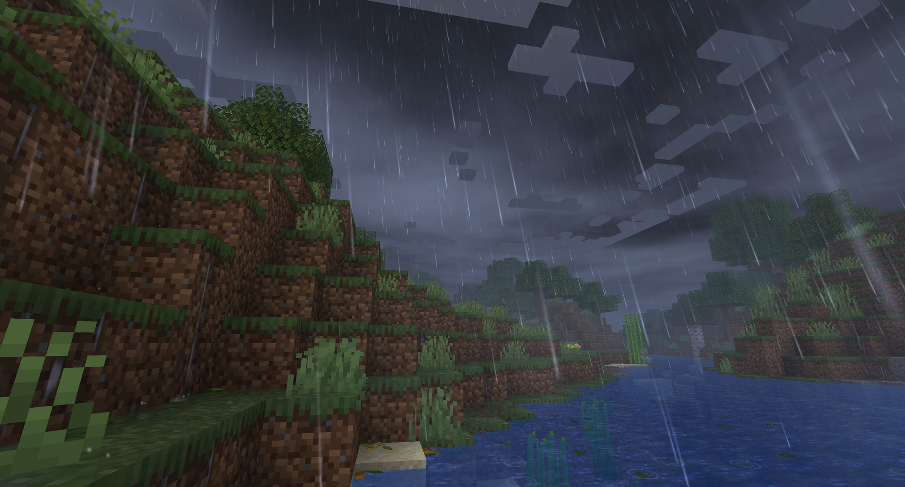

<p align="center">
  
</p>

<h1 align="center">Petrichor: Rain &amp; Storms</h1>

<p align="center">
  <b>Realistic rain and storms</b> - rain that builds up and eases off, puddles, runoff and drips, a soundscape placed in the world and branching lightning with delayed thunder.
</p>

<p align="center">
  <a href="https://www.curseforge.com/minecraft/mc-mods/petrichor-rain-storms"></a>
  <a href="https://www.minecraft.net"></a>
  <a href="https://neoforged.net"></a>
  <a href="LICENSE"></a>
</p>

<p align="center">
  
</p>

## Features

- 🌧️ **Rain that changes** - drizzle, rain, downpour and thunderstorm, swelling and dying down over a minute, slanted by
  a slowly turning wind; sun showers with rainbows.
- 🌫️ **Rainy air** - haze that settles in valleys and fades ridges in layers, drifting showers, a cloud deck with rain
  shafts on the horizon; rain never passes through walls.
- 💧 **Water on the ground** - puddles in hollows that reflect the world and ripple with rings, wet shining ground,
  water running off edges and dripping from roofs, cliffs and leaves after the rain; cauldrons fill as fast as it
  rains.
- 🔥 **Splashes everywhere** - rings on water, spray from leaves and mobs, drops hissing into steam on lava, magma and
  campfires.
- 🔊 **A soundscape in the world** - rain heard from where it falls, every surface with its own recordings, roofs that
  drum by material, rain muffled behind walls and quiet under water.
- ⚡ **Lightning and thunder** - branching bolts with return strokes, flashes in the clouds, thunder arriving after the
  flash at the speed of sound.
- 🎬 **Cinematic storm** - the view darkens for a moment before a strike, a close bolt overexposes the eyes and leaves
  an afterimage, drops freeze in the flash like in a strobe.

## Controls

No keys. Commands for operators:

| Command | Effect |
|---|---|
| `/petrichor weather <drizzle\|rain\|downpour\|thunderstorm\|sun_shower> [seconds]` | Start a rain that builds up to this type |
| `/petrichor weather clear` | Stop the rain |
| `/petrichor wetness <0..1>` | Set how wet the ground is |
| `/petrichor status` | Show the current weather (and the season with Serene Seasons) |
| `/petrichor strike` | Strike lightning near you |

## Crafting

Nothing to craft: the mod changes the weather.

## Configuration

Client options (*Mods -> Petrichor: Rain & Storms -> Config*): quality preset (Low / Medium / High / Ultra), rain density, wind,
splashes, fog, rainy atmosphere, steam on hot blocks, rainbows, Particle Rain integration, puddles, runoff and drips, lightning and flashes, cinematic effects (darkening before
a strike, flash glare and afterimage, deafening close strikes) and sound - rain, drip, wind and thunder volume, roof sounds, muffling behind walls. Server options: chances of each rain type and of sun showers, how fast the rain
changes, how fast the ground gets wet and dries, extra lightning strikes, and with Serene Seasons installed the
"Serene Seasons integration" switch, the strength of the seasons and seasonal lightning.

The mod works on the client alone; installed on the server too, every player sees the same rain, sun showers and wetness.
Muffling is turned off automatically when
[Sound Physics Remastered](https://www.curseforge.com/minecraft/mc-mods/sound-physics-remastered) is installed.

## Compatibility

[](https://modrinth.com/mod/iris) ✅ **[Iris](https://modrinth.com/mod/iris)** (shader packs) - rain is drawn through the pack's weather program, puddles become the pack's water.

[](https://www.curseforge.com/minecraft/mc-mods/oculus) ✅ **[Oculus](https://www.curseforge.com/minecraft/mc-mods/oculus)** (shader packs on Forge) - the same as with Iris.

[](https://modrinth.com/mod/sodium) ✅ **[Sodium](https://modrinth.com/mod/sodium)** - works.

[](https://www.curseforge.com/minecraft/mc-mods/particle-rain) ✅ **[Particle Rain](https://www.curseforge.com/minecraft/mc-mods/particle-rain)** (optional) - Petrichor draws the rain, Particle Rain the snow, sand and fog, all in the same wind.

[](https://www.curseforge.com/minecraft/mc-mods/serene-seasons) ✅ **[Serene Seasons](https://www.curseforge.com/minecraft/mc-mods/serene-seasons)** (optional) - sun showers in spring, storms in summer, long rain in autumn, wet and dry tropical seasons.

[](https://www.curseforge.com/minecraft/mc-mods/sound-physics-remastered) ✅ **[Sound Physics Remastered](https://www.curseforge.com/minecraft/mc-mods/sound-physics-remastered)** (optional) - the mod's own muffling steps aside for Sound Physics.

[](https://www.curseforge.com/minecraft/mc-mods/sable) ✅ **[Sable](https://www.curseforge.com/minecraft/mc-mods/sable)** (optional) - rain and splashes land on the roofs of flying houses and airships and drums on them like on a building's roof.

## Installation

1. Install [NeoForge](https://neoforged.net) for Minecraft 1.21.1.
2. Put this mod into the `mods` folder.

## Building

```sh
./gradlew build
```

The jar is written to `build/libs/`.

## Credits

- Author: **Pocky**.
- Sounds: field recordings from [Freesound](https://freesound.org), all released under
  [Creative Commons 0](https://creativecommons.org/publicdomain/zero/1.0/), edited into loops and single sounds by
  `tools/prepare_sounds.py`:
  - [soft_rain_outside](https://freesound.org/s/768872/) by Gustavo_C
  - [mediumrain](https://freesound.org/s/160699/) by klangfabrik
  - [Rain, Heavy in Woods](https://freesound.org/s/870823/) by CHallSmith
  - [RAINVege_Forest. Drops On Grass, Bushes, Ferns And Leaves](https://freesound.org/s/865323/) by newlocknew
  - [rain medium on street pavement](https://freesound.org/s/454143/) by kyles
  - [Heavy rain, splatty on stone](https://freesound.org/s/338109/) by SpliceSound
  - [Rain On Wood Deck (Burya rain library)](https://freesound.org/s/611421/) by cocaine
  - [Rain, on metallic tin roof, heavy med light](https://freesound.org/s/717874/) by TRP
  - [rooflight raindrops](https://freesound.org/s/242724/) by rucisko
  - [Rain under a skylight](https://freesound.org/s/718977/) by clement.bernardeau
  - [Rain_Hitting_Window_9](https://freesound.org/s/869851/) by SignatureSoundsOrg
  - [Rain on tent](https://freesound.org/s/484723/) by Breviceps
  - [Rain on Tent](https://freesound.org/s/817155/) by craigsmith
  - [Rain, on water lake, modulating light to med](https://freesound.org/s/572429/) by TRP
  - [md10trk1 (rain falling into a puddle)](https://freesound.org/s/124168/) by alienistcog
  - [Indoors_Shed_RainOnTinRoof_01](https://freesound.org/s/521773/) by MrFossy
  - [Medium rain on a tin roof](https://freesound.org/s/771981/) by Sassaby
  - [Rain in a barn](https://freesound.org/s/414162/) by felix.blume
  - [rain medium on roof or large wood shed](https://freesound.org/s/451156/) by kyles
  - [Strong Rain on Roof from Inside of the Room](https://freesound.org/s/428603/) by Erbsland-Music
  - [Wind gusting from window](https://freesound.org/s/574556/) by TRP
  - [eau qui coule - water dripping](https://freesound.org/s/843505/) by vfrattaroli
  - [water dripping from gutter to ground](https://freesound.org/s/180948/) by jc144940
  - [Dripping water](https://freesound.org/s/770443/) by SpinOpel
  - [Water dripping under bridge in small town](https://freesound.org/s/442480/) by BonnyOrbit
  - [Water dripping after the rain](https://freesound.org/s/628404/) by xkeril
  - [gully with water drips](https://freesound.org/s/249927/) by launemax
  - [Water Dripping on Wood (off mic)](https://freesound.org/s/683783/) by Elements-Library
  - [Water Dripping on Thin Metal](https://freesound.org/s/683778/) by Elements-Library
  - [Rain, on leaves, close up, popping, brittle](https://freesound.org/s/577303/) by TRP
  - [Rain, light close drops on leaves](https://freesound.org/s/715698/) by TRP
  - [Very close lightning strike.](https://freesound.org/s/437243/) by Simon Spiers
  - [Closeup Thunder Strike 01](https://freesound.org/s/840628/) by loganzsound
  - [Lightning_direct_hit-Rowy101.wav](https://freesound.org/s/186907/) by Rowy101
  - [2016-10-06 Thunder Crack.wav](https://freesound.org/s/361772/) by kingsrow
  - [Thunder, close crack crash big](https://freesound.org/s/717907/) by TRP
  - [Thunder, close crack light rain](https://freesound.org/s/717909/) by TRP
  - [Thunder, pretty close crack](https://freesound.org/s/567945/) by TRP
  - [thunder](https://freesound.org/s/191992/) by pyer75
  - [Spectacular thunder clap](https://freesound.org/s/865693/) by Valerie-Vivegnis
  - [Loud Thunderclap](https://freesound.org/s/570351/) by JPBILLINGSLEYJR
  - [thunder-rain-middle-distance](https://freesound.org/s/197738/) by ragamuffin
  - [Distant rumbles](https://freesound.org/s/584946/) by richwise
  - [Distant Thunder 2](https://freesound.org/s/581123/) by Fission9
  - [peal of thunder - distant](https://freesound.org/s/243782/) by bastipictures
  - [Splashing Footsteps Shallow Water](https://freesound.org/s/861369/) by ChristopherJngs

<!-- more-mods:start -->
## More mods by Pocky

**🌦️ Weather & nature**

<table>
  <tr>
    <td width="56"><a href="https://www.curseforge.com/minecraft/mc-mods/hoarfrost-snow-blizzards"></a></td>
    <td><a href="https://www.curseforge.com/minecraft/mc-mods/hoarfrost-snow-blizzards"><b>Hoarfrost: Snow & Blizzards</b></a> - seven kinds of snowfall, a living wind and soft snow on the land (<a href="https://github.com/Pocky-l/hoarfrost">source</a>)</td>
  </tr>
  <tr>
    <td width="56"><a href="https://www.curseforge.com/minecraft/mc-mods/rustling-leaves"></a></td>
    <td><a href="https://www.curseforge.com/minecraft/mc-mods/rustling-leaves"><b>Rustling Leaves</b></a> - falling leaves and leaf piles you can wade through, rake and blow away (<a href="https://github.com/Pocky-l/rustling-leaves">source</a>)</td>
  </tr>
</table>

**💡 Light**

<table>
  <tr>
    <td width="56"><a href="https://www.curseforge.com/minecraft/mc-mods/lumen-rigs"></a></td>
    <td><a href="https://www.curseforge.com/minecraft/mc-mods/lumen-rigs"><b>Lumen Rigs</b></a> - aimable spotlights and floodlights with colored light and visible beams (<a href="https://github.com/Pocky-l/lumen-rigs">source</a>)</td>
  </tr>
  <tr>
    <td width="56"><a href="https://www.curseforge.com/minecraft/mc-mods/neon-glowsticks"></a></td>
    <td><a href="https://www.curseforge.com/minecraft/mc-mods/neon-glowsticks"><b>Neon Glowsticks</b></a> - throwable glowsticks that bounce, roll and light up the dark (<a href="https://github.com/Pocky-l/neon-glowsticks">source</a>)</td>
  </tr>
</table>

**🎨 Graphics & performance**

<table>
  <tr>
    <td width="56"><a href="https://www.curseforge.com/minecraft/mc-mods/turbo-for-distant-horizons"></a></td>
    <td><a href="https://www.curseforge.com/minecraft/mc-mods/turbo-for-distant-horizons"><b>Turbo for Distant Horizons</b></a> - Distant Horizons terrain generated many times faster (<a href="https://github.com/Pocky-l/dhturbo">source</a>)</td>
  </tr>
  <tr>
    <td width="56"><a href="https://www.curseforge.com/minecraft/mc-mods/pocky-shaders"></a></td>
    <td><a href="https://www.curseforge.com/minecraft/mc-mods/pocky-shaders"><b>Pocky Shaders</b></a> - a cosy, natural shader pack that sets itself up (<a href="https://github.com/Pocky-l/pocky-shaders">source</a>)</td>
  </tr>
</table>

**⚔️ Gear & gameplay**

<table>
  <tr>
    <td width="56"><a href="https://www.curseforge.com/minecraft/mc-mods/holy-staff"></a></td>
    <td><a href="https://www.curseforge.com/minecraft/mc-mods/holy-staff"><b>Holy Staff</b></a> - a healing staff with three skills and flying heal numbers (<a href="https://github.com/Pocky-l/holy-staff">source</a>)</td>
  </tr>
  <tr>
    <td width="56"><a href="https://www.curseforge.com/minecraft/mc-mods/ranchers-vacpack"></a></td>
    <td><a href="https://www.curseforge.com/minecraft/mc-mods/ranchers-vacpack"><b>Rancher's Vacpack</b></a> - a Slime Rancher vacuum gun for items and small mobs (<a href="https://github.com/Pocky-l/ranchers-vacpack">source</a>)</td>
  </tr>
</table>

**⚡ Tech & energy**

<table>
  <tr>
    <td width="56"><a href="https://www.curseforge.com/minecraft/mc-mods/mekanism-advancedgenerators"></a></td>
    <td><a href="https://www.curseforge.com/minecraft/mc-mods/mekanism-advancedgenerators"><b>Mekanism Advanced Generators</b></a> - nine tiers of solar panels, big solar generators, cubes and cables for Mekanism (<a href="https://github.com/Pocky-l/Mekanism-MoreSolarPanels">source</a>)</td>
  </tr>
</table>

**🛠️ Server tools**

<table>
  <tr>
    <td width="56"><a href="https://www.curseforge.com/minecraft/mc-mods/inventory-backups"></a></td>
    <td><a href="https://www.curseforge.com/minecraft/mc-mods/inventory-backups"><b>Inventory Backups</b></a> - inventory and ender chest backups with one-click restore for admins (<a href="https://github.com/Pocky-l/inventory-backups">source</a>)</td>
  </tr>
</table>

<!-- more-mods:end -->

## License

[MIT](LICENSE)
